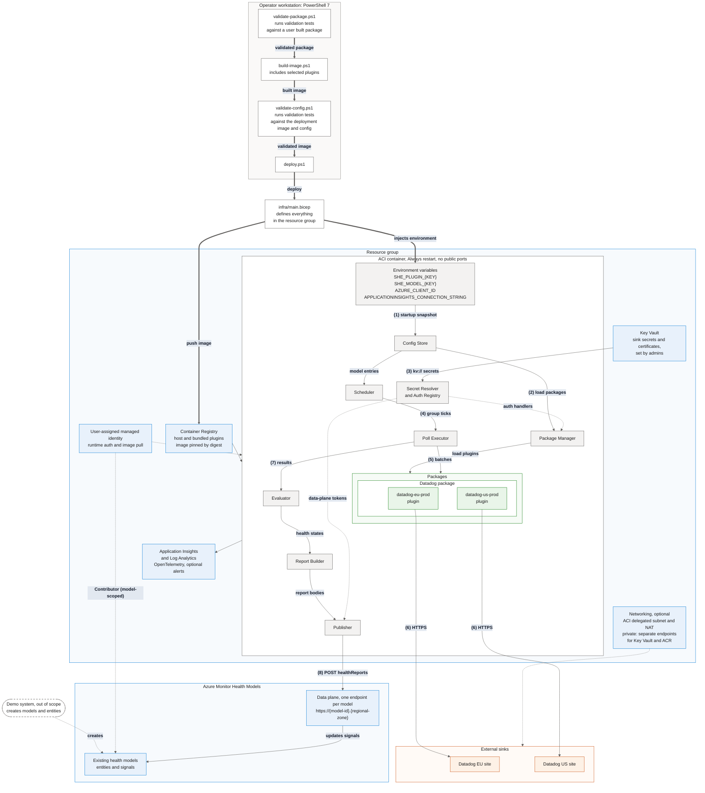

# Self-Hosted Evaluator System Diagram

This diagram shows the system as deployed:

- the Azure resources created by Bicep
- the components inside the container
- the plugin packages and the sink clients built from them
- the external systems it talks to

Numbers in brackets refer to the steps under [Runtime flow](#runtime-flow).

Required environment variables and JSON examples are documented in the
[configuration guide](docs/configuration.md).

## Runtime flow

1. **Config.** Bicep injects one JSON environment entry per sink and per model. The Config Store validates the complete environment once at startup and builds an immutable snapshot. Invalid configuration fails startup; no storage account or hot-reload source is used.
2. **Packages.** The Plugin Manager loads assemblies and manifests already bundled under `/app/packages` in the image, with one `AssemblyLoadContext` per package. Each plugin entry creates a sink client with auth-configured `HttpClient`s; plugins never see raw credentials. No runtime package download is required.
3. **Secrets.** The Secret Resolver resolves `kv://` references from Key Vault. The Auth Registry builds auth handlers for the sink clients and data-plane tokens for the Publisher, using those secrets where a profile needs them.
4. **Scheduling.** The Scheduler groups signals by (plugin, interval) and fires aligned ticks.
5. **Polling.** The Poll Executor splits each group into batches and sends them to the plugin's sink client. It applies the plugin's batch size, rate limit, concurrency and timeout.
6. **Querying.** Each sink client queries its own sink over HTTPS.
7. **Evaluation.** The Evaluator turns the results into health states. Failures become `Unknown`. The Report Builder then builds the report bodies.
8. **Publishing.** The Publisher sends each report to its model's data plane, with rate limiting, retries and superseding for each model. It authenticates as the identity set in the model's `healthModel.auth`, which defaults to the managed identity.

Plugin names such as `datadog-eu-prod`, `datadog-us-prod` are examples. Each has its own `SHE_PLUGIN_<KEY>` JSON entry referencing a shared image-bundled package.
